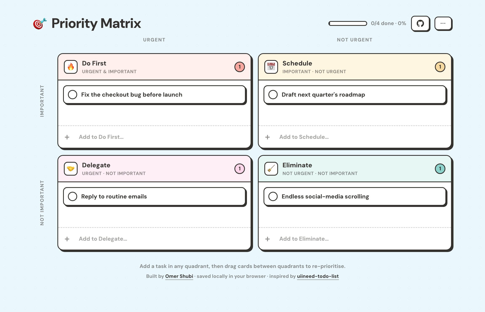

# 🎯 Priority Matrix

A minimalist to-do list that organises tasks by the **[Eisenhower method](https://en.wikipedia.org/wiki/Time_management#The_Eisenhower_method)** — every task is sorted by **importance** and **urgency** into a 2×2 matrix, so you always know what to do first.

**[▶ Live demo](https://omershubi.github.io/priority-matrix/)**



No build step — a single self-contained HTML file. Local-first: your data is saved in your browser, with optional **Google sign-in + cloud sync** (via Firebase) to use the same matrix on your phone and computer.

## The matrix

|                   | Urgent            | Not urgent          |
| ----------------- | ----------------- | ------------------- |
| **Important**     | 🔥 **Do First**   | 📅 **Schedule**     |
| **Not important** | 🤝 **Delegate**   | 🧹 **Eliminate**    |

## Features

- **Add tasks inline** — every quadrant has its own input, so tasks land straight where they belong.
- **Drag & drop** tasks between quadrants to re-prioritise — changes are saved automatically.
- Mark done / undo, **double-click to edit**, and delete — with a satisfying flatten-on-hover.
- A live completion bar in the header tracks your progress at a glance.
- A compact **⋯ menu** for hide/show completed, clear completed, reset, and JSON **export / import** (imports append to your list).
- Fully responsive — the 2×2 grid stacks into a single column on mobile.
- Everything is stored in `localStorage`. Optionally **sign in with Google** to back up and sync tasks across devices — edits, moves and deletions merge per task, so working offline on two devices is safe.
- Installable (**Add to Home Screen**) and works offline after the first visit.

## Usage

Just open [`index.html`](index.html) in any modern browser — or visit the [live demo](https://omershubi.github.io/priority-matrix/).

Press <kbd>Enter</kbd> to add a task, double-click a task to edit it, and drag cards between quadrants to change their priority.

## Login + sync (optional)

Sync is off until you add a Firebase config — without one the app runs exactly as before and hides all sign-in UI. One-time setup, ~10 minutes, all within Firebase's free Spark plan:

1. **Create a project** at [console.firebase.google.com](https://console.firebase.google.com) (e.g. `priority-matrix`). No need for Google Analytics.
2. **Enable Google sign-in**: Build → Authentication → Get started → Sign-in method → Google → Enable → Save.
3. **Create the database**: Build → Firestore Database → Create database → Start in production mode (the rules in this repo take over on deploy).
4. **Register a web app**: Project settings (gear icon) → Your apps → Web (`</>`) → register. Copy the `firebaseConfig` values it shows.
5. **Paste the config** into [`index.html`](index.html) — find `FIREBASE_CONFIG` near the top of the script and replace the `PASTE_...` placeholders (`apiKey`, `authDomain`, `projectId`, `appId`).
6. **Put your project id** in [`.firebaserc`](.firebaserc) (replace `priority-matrix` if you named it differently).
7. **Deploy** the Firestore rules and the site:

```bash
npm install -g firebase-tools
```

```bash
firebase login
```

```bash
firebase deploy
```

The app goes live at `https://<project-id>.web.app` and `https://<project-id>.firebaseapp.com`.

**Keeping the GitHub Pages version too?** Once the config is pasted, the GitHub Pages copy gets sign-in as well — just add `omershubi.github.io` under Authentication → Settings → **Authorized domains**. Both URLs then share the same synced data.

> **iPhone tip:** open the **`.firebaseapp.com`** URL in Safari and use Share → *Add to Home Screen*. Using that domain keeps Google sign-in working in home-screen (standalone) mode, where popups are restricted.

Each user's tasks live in one Firestore document (`users/<uid>`), and [`firestore.rules`](firestore.rules) only lets a signed-in user read and write their own. The Firebase web config isn't a secret — it only identifies the project; the rules are what protect the data.

**Moving existing data:** `localStorage` doesn't carry across domains. On the old URL use ⋯ → **Export JSON**, then on the new one ⋯ → **Import JSON**. After you sign in, tasks already on a device are merged into your account automatically.

## Tech

Vanilla HTML, CSS, and JavaScript in one file. No frameworks, no dependencies, no build tooling. External resources are the [DM Sans](https://fonts.google.com/specimen/DM+Sans) web font (it falls back gracefully to a system font offline) and — only when sync is configured — the Firebase SDK, loaded on demand from Google's CDN. A small service worker ([`sw.js`](sw.js)) caches the app for offline use.

## Credits

Built by [Omer Shubi](https://omershubi.github.io/).

The visual design and some CSS — the dotted background, the neo-brutalist card shadows, and the flatten-on-hover interaction — are adapted from the lovely [uiineed-todo-list](https://github.com/ricocc/uiineed-todo-list) by [ricocc](https://github.com/ricocc) (MIT licensed), reimagined around the Eisenhower matrix. Their copyright notice is preserved in [THIRD_PARTY_NOTICES.md](THIRD_PARTY_NOTICES.md).

## License

This project is [MIT](LICENSE) © 2026 Omer Shubi. It incorporates MIT-licensed material from uiineed-todo-list (© 2025 Ricocc); see [THIRD_PARTY_NOTICES.md](THIRD_PARTY_NOTICES.md).
